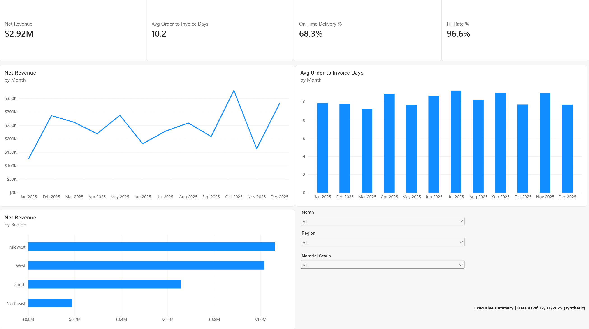
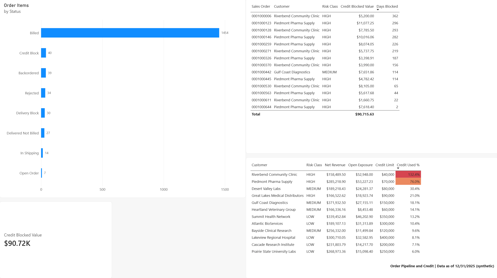
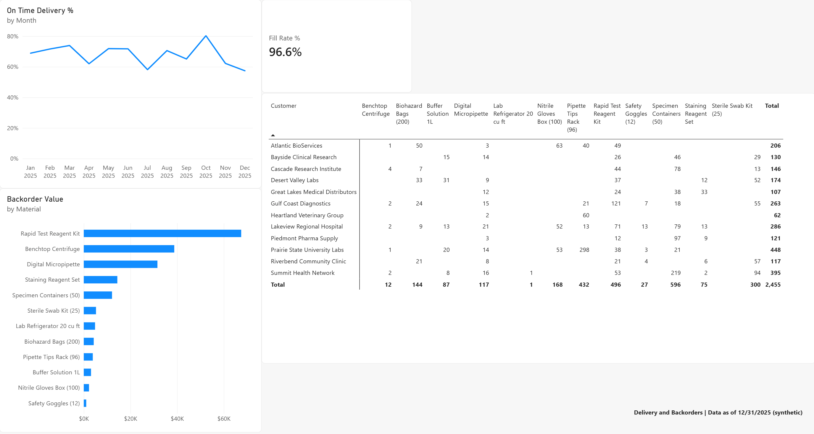
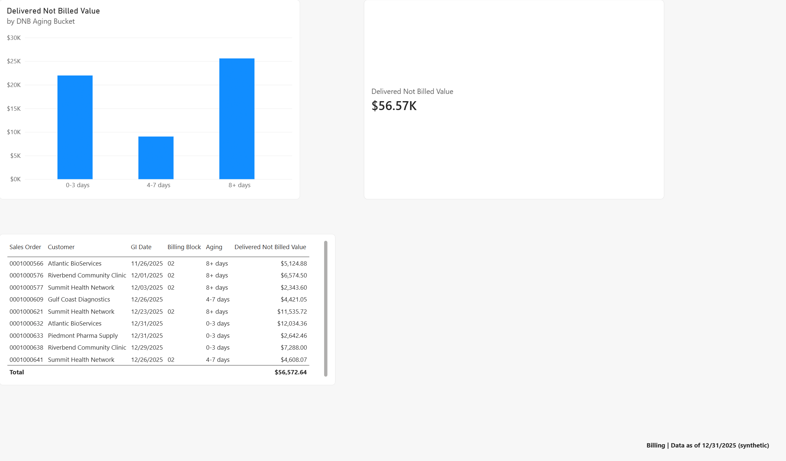
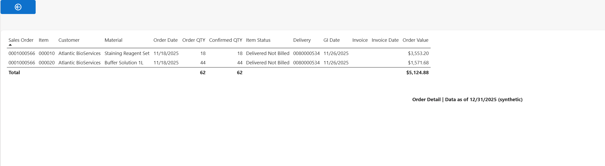

# Order-to-cash performance dashboard (SAP SD + SQL Server + Power BI)

A portfolio project that follows sales orders through delivery and billing for a fictional lab supply distributor, using data shaped like SAP SD tables. I wrote the business requirements, built the data model and SQL, defined and tested the KPIs, and designed the Power BI report the way I would on a real SAP reporting project.

All data is synthetic. No client or employer data is used.

## The business problem

Northfield Lab Supply Co. runs order-to-cash in SAP S/4HANA. Customer Service, Credit and Billing each build their own weekly Excel report from VA05, VL06O and VF04, and the numbers rarely agree. Blocked orders sit for weeks, backorders are found when the customer calls, and shipped goods wait to be billed at month end.

The goal was one report that shows where every order item is in the flow and which exceptions each team needs to work.

## What the data showed (as of 2025-12-31)

- $2.92M net billed revenue from 599 invoices. Average order-to-invoice cycle time was 10.2 days.
- On-time delivery was 68.3%. Almost a third of shipments went out after the requested date.
- 14 orders worth $90.7K were still on credit block, and 10 of them had been blocked for more than 90 days. Nobody was clearing or rejecting them.
- Riverbend Community Clinic was at 132% of its credit limit.
- Backorders totaled $188.9K. One material, Rapid Test Reagent Kit (LAB-2001), made up 36% of that value.
- $56.6K was shipped but not billed. Every order more than a week old in that list had a billing block that was never released.

## What's in the repo

```
data/                     SAP-style CSV extracts (KNA1, MARA, VBAK, VBAP, VBEP, LIKP, LIPS, VBRK, VBRP)
scripts/generate_data.py  Seeded generator for the synthetic data
scripts/expected_results.py  Independent pandas calculation of every KPI, used for testing
sql/01_create_tables.sql  SQL Server schema
sql/02_load_data.sql      BULK INSERT load and row count check
sql/03_views.sql          Reporting views, including the item-level document flow view
sql/04_kpi_queries.sql    KPI queries and data quality checks
docs/requirements.md      Business requirements, user stories, KPI definitions
docs/test_cases.md        Test cases with expected results
docs/powerbi_build_guide.md  Data model, DAX measures and page layout
docs/portfolio_writeup.md Resume bullets, LinkedIn post and interview walkthrough
OTC_Dashboard.pbix        Power BI report (5 pages, Order Detail is a drill-through)
screenshots/              One image per report page
```

## How the data is modeled

The core is `otc.vw_OTC_ItemFlow`, one row per sales order item, joined to its schedule line, delivery and valid invoice. It is the same chain you would see in VA03 document flow. Each item gets one status: Rejected, Credit Block, Delivery Block, Billed, Delivered Not Billed, In Shipping, Backordered or Open Order. The rules are in `docs/requirements.md`, section 8.

The data includes the cases that make SD reporting hard in practice: partial confirmations from ATP, credit blocks and releases, delivery and billing blocks, rejected items, and invoices cancelled with S1 and re-billed.

## How to run it

1. Run `python scripts/generate_data.py` to regenerate the CSVs (optional, they are already in `data/`).
2. In SQL Server, run the four scripts in `sql/` in order.
3. Check the query results against `docs/test_cases.md`.
4. Build the report with `docs/powerbi_build_guide.md`.

## Screenshots











## Tools

SAP SD data structures, SQL Server (T-SQL), Power BI (DAX),and a cross-check script for test data and validation.
